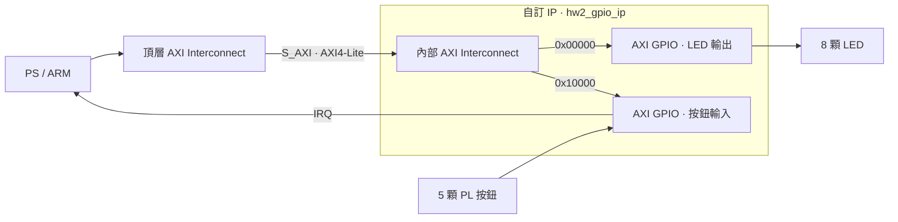

# EGO-XZ7 HW2.1｜Vivado 自訂 GPIO IP 封裝

HW2.1 的主要成果是用 Vivado IP Packager 把 LED 輸出、按鈕輸入與中斷整合成一顆可重用的 **`hw2_gpio_ip 1.0`**。封裝定義對外接腳、AXI 介面與內部位址，讓其他工程可以從 IP Catalog 加入這顆元件。

## 封裝範圍

內部 AXI Interconnect 依位址把讀寫分送到兩組 Xilinx AXI GPIO。上層透過一個 `S_AXI` 存取這兩組 GPIO，並接上時脈、Reset、LED、按鈕與中斷。

## Vivado 封裝流程

1. 建立子系統 Block Design，配置 LED 和按鈕 GPIO，並接出按鈕中斷。
2. 加入內部 AXI Interconnect，為兩組 GPIO 各分配 64 KiB 位址空間。
3. 驗證設計並產生 HDL wrapper，再用 IP Packager 定義 IP 識別、產生 XGUI 並檢查完整性。
4. 在獨立工程從 IP Catalog 加入這顆 IP，驗證連線、位址映射與輸出產生。

封裝由 [package_gpio_ip.tcl](scripts/package_gpio_ip.tcl) 重建。介面與暫存器細節見 [GPIO IP 設計說明](docs/GPIO_IP_DESIGN.md)。

## 對外介面與位址

| 項目 | 本版設定 |
|---|---|
| 開發板／器件 | EGO-XZ7 v1.0，xc7z020clg484-1 |
| 工具 | Vivado／Xilinx SDK 2018.3 |
| IP 識別 | f115112124.org:user:hw2_gpio_ip:1.0 |
| Catalog 顯示名稱 | HW2 LED and Button GPIO |
| AXI | AXI4-Lite，32-bit data，17-bit local address |
| 位址視窗 | 0x41200000～0x4121FFFF，128 KiB |
| LED GPIO | 偏移 0x00000，8-bit output |
| 按鈕 GPIO | 偏移 0x10000，5-bit input，中斷啟用 |
| 時脈 | FCLK0 50 MHz |
| 中斷 | irq 接 IRQ_F2P[0]，新 HDF 確認 ID 61／LEVEL_HIGH |

## 封裝與系統驗證

ARM 的 C 程式透過 [hw2_gpio.h](firmware/hw2_demo/hw2_gpio.h) 讀寫暫存器。LED 每 500 ms 加 1。按下 S6 後，GPIO 發出中斷，主程式經過 20 ms 防彈跳確認按下，將 LED 清零兩秒，再從 1 恢復。這個案例用來檢查 IP 的輸出、輸入和中斷路徑。

| 項目 | 新封裝版結果 |
|---|---|
| IP Packager／Catalog 重用 | 通過，於新工程建立 IP 並生成輸出 |
| Block Design | Validate 通過，映射 128 KiB |
| AXI／GPIO 功能模擬 | 通過 176 項 assertion，含重複協定穩定性檢查 |
| 硬體建置 | 合成、Implementation、Bitstream 完成 |
| DRC | 0 違規 |
| 設定的時序條件 | 通過，WNS 13.134 ns，WHS 0.034 ns |
| SDK | BSP／應用程式編譯完成 |
| HDF／BIT 一致性 | 嵌入的 BIT 與匯出 BIT 相同 |
| 新封裝版上板 | **尚待實板驗證** |

原本使用分立 GPIO 的 HW2 已上板驗證 LED 計數與 S6 暫停恢復。HW2.1 仍待上板確認。

## 專案內容

| 位置 | 內容 |
|---|---|
| [`scripts/package_gpio_ip.tcl`](scripts/package_gpio_ip.tcl) | 自訂 IP 原始配置，使用 Vivado 產生 `ip_repo/hw2_gpio_ip_1_0` |
| [`docs/GPIO_IP_DESIGN.md`](docs/GPIO_IP_DESIGN.md) | IP 結構、暫存器與封裝說明 |
| [`firmware/hw2_demo/main.c`](firmware/hw2_demo/main.c) | ARM 主程式、GIC 與 ISR |
| [`firmware/hw2_demo/hw2_gpio.h`](firmware/hw2_demo/hw2_gpio.h) | 自訂 IP 的 MMIO 小型介面 |
| `scripts/` | 可重現封裝、主系統建置、硬體匯出與 SDK 建置來源 |
| `tests/` | 從 Catalog 建立 IP 的 AXI 功能測試平台 |
| `constraints/`、`reference/` | 腳位約束、PS7 參數與板卡設定來源 |
| [`docs/state_machine.md`](docs/state_machine.md) | ARM 計數與防彈跳狀態機 |

## 重建順序

先由封裝腳本產生 IP，再用硬體建置腳本產生 BIT 和 HDF。使用同一份 HDF 建立 SDK 工程，以確保 ELF 對應同版硬體。

1. `vivado -mode batch -source scripts/package_gpio_ip.tcl`
2. `vivado -mode batch -source scripts/build_hardware.tcl`
3. `xsct scripts/create_sdk_workspace.tcl`

可另跑硬體模擬：`vivado -mode batch -source tests/run_sim.tcl -tclargs ip_repo f115112124.org:user:hw2_gpio_ip:1.0`。

板卡設定見 [參考來源](reference/SOURCES.md)。原本已上板的版本見 [EGO-XZ7 HW2](https://github.com/f115112124/EGO-XZ7-HW2)。
