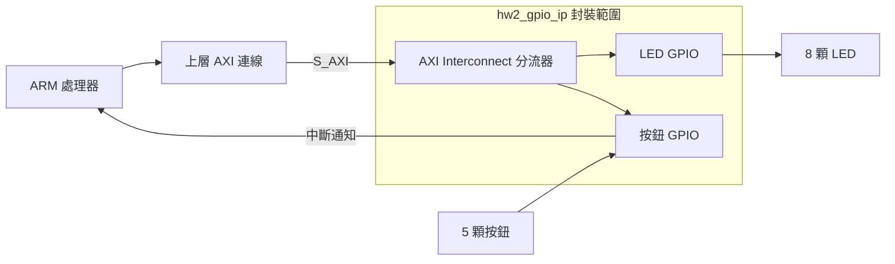

# EGO-XZ7 HW2.1｜把 LED 和按鈕包成一顆 IP

這次作業是把原本分開的 **LED 控制**和**按鈕讀取**，在 Vivado 裡包成一顆叫做 **`hw2_gpio_ip`** 的硬體元件。包好後，其他工程可以從 Vivado 的 IP Catalog（元件清單）加入它。

## 裡面包了什麼？

- **LED GPIO** 負責控制 8 顆 LED。
- **按鈕 GPIO** 負責讀取 5 顆按鈕。按鈕訊號一變，它就能發出中斷通知 ARM。
- **AXI Interconnect** 像分流器。ARM 送來讀寫要求時，它看位址，決定交給 LED 還是按鈕。

兩組 GPIO 都用 Vivado 提供的 AXI GPIO 元件。這次作業自己完成的是接線、分配位址，以及把整組電路包成一顆 IP。上層只要用一個 `S_AXI` 入口，就能讀寫兩組 GPIO。



## 怎麼包起來？

1. 在 Vivado 的方塊圖裡放入兩組 GPIO，分別接到 LED 和按鈕，並把按鈕的中斷線接出來。
2. 在兩組 GPIO 前面加一個 AXI 分流器，讓 LED 和按鈕各有自己的位址。
3. 用 IP Packager 把接好的電路封裝成 `hw2_gpio_ip`。
4. 在另一個 Vivado 工程從 IP Catalog 加入這顆 IP，確認能接線並使用。

這些設定都寫在 [封裝腳本](scripts/package_gpio_ip.tcl)。位址和接腳的完整資料見 [GPIO IP 設計說明](docs/GPIO_IP_DESIGN.md)。

## 怎麼驗證？

ARM 上的 [C 程式](firmware/hw2_demo/main.c) 每半秒更新一次 LED。按下 S6 後，按鈕 GPIO 會通知 ARM。程式等訊號穩定 20 毫秒，確認按下後讓 LED 熄滅兩秒，再從 1 開始計數。

HW2.1 已確認能在新工程加入這顆 IP，AXI 讀寫、LED 輸出、按鈕輸入與中斷也已通過[模擬測試](tests/tb_hw2_gpio.sv)。硬體設定檔和 ARM 程式都已編譯完成，仍待上板驗證。原本使用分立 GPIO 的版本已在板上驗證 S6 的反應。[原版 HW2](https://github.com/f115112124/EGO-XZ7-HW2)

## 中斷時會顯示什麼？

GPIO 中斷送進 ARM 後，SDK Terminal 會顯示下面這行文字。events 是中斷事件的累計值。

```text
==== GPIO INTERRUPT RECEIVED (IRQ=61, events=1) ====
```

程式確認按鈕按下後，還會顯示 BUTTON 訊息，兩秒到期再顯示 Resume。按下、放開和接點彈跳都可能產生中斷，所以一次操作可能有多筆事件。ISR 先記下事件，再由主程式印出文字。

## 工程重建

工程使用 EGO-XZ7 v1.0（`xc7z020clg484-1`）和 Vivado／Xilinx SDK 2018.3。[板卡設定來源](reference/SOURCES.md)

```sh
vivado -mode batch -source scripts/package_gpio_ip.tcl
vivado -mode batch -source scripts/build_hardware.tcl
xsct scripts/create_sdk_workspace.tcl
```

要重跑 IP 模擬，可在封裝後執行以下指令。

```sh
vivado -mode batch -source tests/run_sim.tcl -tclargs ip_repo f115112124.org:user:hw2_gpio_ip:1.0
```
